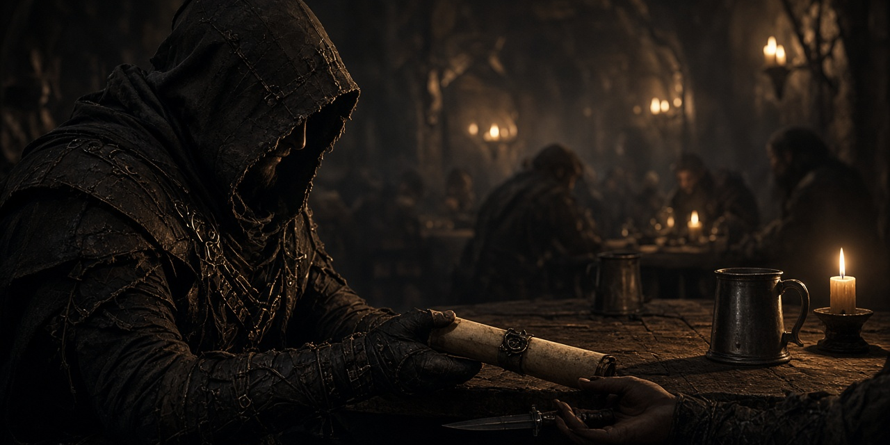

# The Turncoat Contract

*An ambushed payroll, a sergeant with a short list of people she trusts, and a traitor wearing the Blackshield.*

A questline for the Blackshield mercenary company. Sergeant **Hjalla Iron-Vow** camps by the **Solitude Stables**: the company payroll wagon never reached Falkreath, four of hers died with it, and the raiders knew the route. Someone inside sold it.

**Status: v0.1.4, early beta.** It passes every automated check in the build (Papyrus compile, plugin and dialogue validation, byte-exact round trip, voice file and SEQ checks, FOMOD schema, the series compatibility check) but has not been playtested in-game yet. Expect rough edges and please report what you find. See [docs/TESTING.md](docs/TESTING.md).

- Game: Skyrim Special Edition / Anniversary Edition 1.6.x (also fine on 1.5.97). Works on Windows and on Linux through Proton.
- Requirements: none beyond the base game. No SKSE, no SkyUI, no DLC, no Creation Club content required.
- Plugin: `TurncoatContract.esp`, ESL-flagged, Skyrim.esm is the only master. **No vanilla records edited** (zero overrides).
- Part of the synthalorian series and compatible with all of it: [Blackshield Company](https://github.com/synthalorian/blackshield-company), [Bounties of Oblivion](https://github.com/synthalorian/bounties-of-oblivion), [Contract Hunter](https://github.com/synthalorian/contract-hunter), [Steel Oath](https://github.com/synthalorian/steel-oath), [Ember Smithing](https://github.com/synthalorian/ember-smithing), [The Gray-Mane Debt](https://github.com/synthalorian/the-gray-mane-debt), [Blackshield Codex](https://github.com/synthalorian/blackshield-codex), [War Banners](https://github.com/synthalorian/war-banners), [Roadwarden](https://github.com/synthalorian/roadwarden), [Sellsword Roster](https://github.com/synthalorian/sellsword-roster), [The Turncoat Contract](https://github.com/synthalorian/the-turncoat-contract), [The Ledger of Ash](https://github.com/synthalorian/the-ledger-of-ash), [Oathbreaker's Price](https://github.com/synthalorian/oathbreakers-price), [Champion's Reforge](https://github.com/synthalorian/champions-reforge), [The Barrow-Iron Pact](https://github.com/synthalorian/barrow-iron-pact). Own prefix (`TTC_`), records, globals, scripts and files; checked by loading all 15 plugins together (see [tools/modkit](tools/modkit/README.md)).

## The quest

1. **"You wear the Blackshield."** Talk to Hjalla near the Solitude Stables (level 8+). Accept and she hands you a contract writ and a plain **Blackshield Oathblade**.
2. **The ambush site** is a dungeon in Haafingar, the Reach, Hjaalmarch, Whiterun or Falkreath hold, picked when the quest starts. The raider captain who led the ambush waits at its entrance.
3. **The payroll ledger and the sealed orders** are on the captain. Reading the orders names the traitor: **Corporal Edric Vane**, Hjalla's own man, now hiding near Falkreath.
4. **Back to Hjalla** with the ledger: she re-edges your blade (**Oathblade, Edged**: shock enchantment) and sends you after Vane.
5. **Vane** tells you why he did it if you ask, then the choice is yours.

| Choice | How | Reward |
|---|---|---|
| Arrest | "Surrender. You'll answer to Hjalla." then report | **Oathblade of Mercy** (ebony, 15 damage, absorb health + shock) and **Hjalla's Captain Shield** (fortify block, resist magic), 500 gold |
| Kill | "There's only one answer for a turncoat." (or kill him any other way), then report | **Oathblade of Judgement** (ebony, 15 damage, fire + absorb stamina), 500 gold, Vane's **Emerald Signet** (fortify one-handed, stamina) from his body |
| Take the bribe | "Make me an offer. (1500 gold)" | 1,500 gold and Vane's Emerald Signet. Hjalla won't speak to you again, and the blade stays at its second tier |

## Items

- Blackshield Oathblade (3 tiers, swapped in place and re-equipped if you were holding it)
- Hjalla's Captain Shield
- Vane's Emerald Signet
- Contract Writ, Sealed Orders, Payroll Ledger

## Series integration (optional, no masters)

When other mods of the series are installed, this one notices. Nothing here is a master and nothing is required: a script on the player looks each plugin up at runtime with `Game.GetFormFromFile` (vanilla Papyrus since 2012, no SKSE) on every game load, and when the plugin is missing the call returns None and that feature is skipped.

| Mod | Reads | Effect |
|---|---|---|
| Blackshield Company | `BSC_Rank` | Hjalla recognizes you from the company rolls (different opening) and the final reward includes a 250 gold company bonus (`TTC_CompanyBonus`). |
| Steel Oath | `SOT_ActiveCount` | Vane greets you differently: he can see you carry an oath. |
| Contract Hunter | `CHT_OpenCount` | Detected and logged (`TTC_SeriesCHT`); reserved for later dialogue. |

## Unvoiced dialogue

All 28 new lines are unvoiced, shown as subtitles, and each one ships with a silent voice file sized to its length, so subtitles stay on screen (same approach as The Gray-Mane Debt). Turn subtitles on. Fuz Ro D'oh is not needed and doesn't conflict.

## Install

Grab `TurncoatContract-0.1.4.zip` from [Releases](https://github.com/synthalorian/the-turncoat-contract/releases) (FOMOD installer).

- **Mod Organizer 2** or **Vortex**: install the zip and enable `TurncoatContract.esp`.
- **Manual (Linux/Proton)**: copy everything inside `00 Core/` (plugin, `Scripts/`, `SEQ/`, `Sound/`) into `.../steamapps/common/Skyrim Special Edition/Data/` and add `*TurncoatContract.esp` to `Plugins.txt` in the Proton prefix (`.../compatdata/489830/pfx/drive_c/users/steamuser/AppData/Local/Skyrim Special Edition/`).

Safe to add to an existing save. Finish the quest before uninstalling.

## Console tunables

```
set TTC_MinLevel to 8
set TTC_RewardGold to 500
set TTC_BribeGold to 1500
set TTC_CompanyBonus to 250
```

## What got scaled down

- No scenes, packages or escort: an arrested Vane fades out a few seconds after surrendering instead of being marched to Solitude.
- Hjalla and Vane are new NPCs spawned at vanilla map markers (Solitude Stables, Falkreath), not hand-placed in cells, so no navmesh or Creation Kit work was needed.
- The ambush is told through notes and a dungeon boss; there is no wrecked-wagon set piece.

## Known issues and risks

- Not playtested in-game.
- Hjalla stands at the Solitude Stables map marker; mods that rebuild that area may leave her standing somewhere odd.
- Weapon tiers are separate records; tempering on an earlier tier is lost when it is swapped.

## Build from source

`./build.sh` on Linux builds the release zip: Papyrus is compiled with the open-source [papyrus-compiler](https://github.com/russo-2025/papyrus-compiler) against clean-room vanilla declaration stubs, the plugin is generated from C# with [Mutagen](https://github.com/Mutagen-Modding/Mutagen) (`src/plugin/TurncoatContract.Generator`: `Mod.cs` holds this mod, `Kit.cs`/`Program.cs`/`Vanilla.cs` are shared by the third wave), the SEQ file and silent voice files are written next to it, and everything is validated. The zip is reproducible: a fresh clone rebuilds it byte for byte. `src/plugin/formids.json` pins every FormID; never edit or reuse entries.

Current build: 66 new records (FormIDs 800-841): Armor 2, Book 3, DialogBranch 5, DialogResponses 18, DialogTopic 11, Faction 2, FormList 1, GlobalFloat 8, Message 2, Npc 3, ObjectEffect 5, Quest 2, Weapon 4; 12 Papyrus scripts; 28 silent voice files; 1 SEQ entry.

## Support

Donations are optional. Nothing in the mod is gated on them.

- GitHub Sponsors: https://github.com/sponsors/synthalorian
- Ko-fi: https://ko-fi.com/synthalorian

## Credits

- Built with [Mutagen](https://github.com/Mutagen-Modding/Mutagen) and [russo-2025/papyrus-compiler](https://github.com/russo-2025/papyrus-compiler).
- Skyrim and every referenced vanilla record and mesh belong to Bethesda Softworks. This mod references them from Skyrim.esm and ships no Bethesda assets.

## Support

Donations are optional. Nothing in the mod is gated on them.

- GitHub Sponsors: https://github.com/sponsors/synthalorian
- Ko-fi: https://ko-fi.com/synthalorian
